# TASKS — r-toolkit

| Field | Value |
| --- | --- |
| PRD | [`PRD.md`](PRD.md) |
| Date | 2026-11-17（三輪稽核修訂後 v4） |
| Status | working contract |
| Workflow | 四類 → 模型閘 / 守衛閘 → 派工 |
| Task files | `tasks/<id>-<title>.md`，一任務一檔 |
| Scope audit | 三輪共 30 位稽核員、257 條回報；修訂 A-1 至 A-27 見 `AMENDMENTS.md` |

`TASKS.md` 是指引層：DAG、任務登記、需求追溯、閘門與派工順序。任務本文在各目的檔案裡。一檔一寫者。

## 1. Class register

| Class | Count | Flow / path covered |
| --- | --- | --- |
| construction | 14 | F1、F2、共用統計量、F3–F11、測試台 |
| verification A | 11 | F1–F11 各一個模型 |
| verification C | 3 | `REQ-A-1/2/3/6/7` 合併、`REQ-A-4`、`REQ-A-5` |
| migration | 0 | 無（greenfield） |
| removal | 0 | 無 |

## 2. DAG

```mermaid
flowchart TD
  subgraph C["Construction"]
    T01["T01 construction · 環境還原與共用常數"]
    T02["T02 construction · 分析母體與清洗資料集"]
    T03["T03 construction · 共用統計量"]
    T04["T04 construction · 財富層的四格與關聯強度"]
    T05["T05 construction · 年齡帶與婚配分層"]
    T06["T06 construction · 能力分位與兩期追蹤"]
    T07["T07 construction · 三層解釋力比較"]
    T08["T08 construction · 語言文化的小樣本材料"]
    T09["T09 construction · 宏觀三欄的值域與角色"]
    T10["T10 construction · 相關審核表"]
    T11["T11 construction · SAS 端對照程式"]
    T12["T12 construction · 兩端差異表"]
    T13["T13 construction · 單一入口與數字對照表"]
    T14["T14 construction · 測試台（共用樣本、種子與暫存）"]
  end
  subgraph V["Verification A（模型）"]
    V01["V01 verification A · F1 環境還原 的模型"]
    V02["V02 verification A · F2 母體 的模型"]
    V03["V03 verification A · F3 財富層 的模型"]
    V04["V04 verification A · F4 年齡層 的模型"]
    V05["V05 verification A · F5 能力層 的模型"]
    V06["V06 verification A · F6 模型比較 的模型"]
    V07["V07 verification A · F7 語言文化 的模型"]
    V08["V08 verification A · F8 宏觀 的模型"]
    V09["V09 verification A · F9 審核表 的模型"]
    V10["V10 verification A · F10 兩端對照 的模型"]
    V11["V11 verification A · F11 交付 的模型"]
  end
  subgraph K["Verification C（架構檢查）"]
    V12["V12 verification C · 結構規則檢查"]
    V13["V13 verification C · 套件同步檢查"]
    V14["V14 verification C · 輸出可重建檢查"]
  end
  G1{"模型閘 G1"}
  G2{"守衛閘 G2 · C 檢查"}
  T01 --> T02
  T01 --> T03
  T02 --> T04
  T03 --> T04
  T02 --> T05
  T03 --> T05
  T02 --> T06
  T03 --> T06
  T02 --> T07
  T03 --> T07
  T02 --> T08
  T03 --> T08
  T02 --> T09
  T03 --> T09
  T02 --> T10
  T03 --> T10
  T02 --> T11
  T04 --> T11
  T05 --> T11
  T06 --> T11
  T02 --> T12
  T04 --> T12
  T05 --> T12
  T06 --> T12
  T11 --> T12
  T04 --> T13
  T05 --> T13
  T06 --> T13
  T07 --> T13
  T08 --> T13
  T09 --> T13
  T10 --> T13
  T11 --> T13
  T12 --> T13
  T01 --> T14
  T02 --> T14
  T01 --> V01
  T14 --> V01
  G1 --> V01
  T02 --> V02
  T14 --> V02
  G1 --> V02
  T04 --> V03
  T14 --> V03
  G1 --> V03
  T05 --> V04
  T14 --> V04
  G1 --> V04
  T06 --> V05
  T14 --> V05
  G1 --> V05
  T07 --> V06
  T14 --> V06
  G1 --> V06
  T08 --> V07
  T14 --> V07
  G1 --> V07
  T09 --> V08
  T14 --> V08
  G1 --> V08
  T10 --> V09
  T14 --> V09
  G1 --> V09
  T12 --> V10
  T14 --> V10
  G1 --> V10
  T13 --> V11
  T14 --> V11
  G1 --> V11
  G2 --> V12
  G2 --> V13
  G2 --> V14
  T01 --> G1
  T02 --> G1
  T03 --> G1
  T14 --> G1
  T13 --> G2
  T14 --> G2
```

`A --> B` 表示 B 依賴 A。閘門節點無擁有者、無檔案。

**Greenfield 的三處偏離。** 一，本計劃無 migration 與 removal，守衛閘沒有「先於變更」的物件，`G2` 的意義為「全部建構完成後，三條架構檢查開跑」。二，`REQ-A-4` 今日已被違反，`V13` 寫成兩階段：凍結清單由主代理於 `T01` 開工前產出 `pins_before_T01.md`（第 0 波），之後唯讀。三，`REQ-A-5` 今日無基線，`V14` 以兩次獨立執行互比取代前後互比。

## 3. Task register

| Task | Class | Title | Depends on | Files owned | REQs | Seam / flow | File |
| --- | --- | --- | --- | --- | --- | --- | --- |
| `T01` | construction | 環境還原與共用常數 | — | `.Rprofile`、`programs/R/00_setup.R`、`renv/activate.R`、`renv.lock`、`output/logs/00_setup.log` | `REQ-F-F1-1`、`REQ-A-2`、`REQ-A-4`（三者皆由本任務交付，`V12`／`V13` 判定） | programs/R/00_setup.R | [`tasks/T01-環境還原與共用常數.md`](tasks/T01-環境還原與共用常數.md) |
| `T02` | construction | 分析母體與清洗資料集 | `T01` | `programs/R/01_prep_data.R`、`data/processed/ams2640_clean.csv`、`data/processed/ams2640.sas7bdat`、`data/processed/ams2640.xpt`、`output/tables/population_ledger.csv`、`output/logs/01_prep.log` | `REQ-F-F2-1`、`REQ-F-F2-2`、`REQ-F-F2-3` | programs/R/01_prep_data.R | [`tasks/T02-分析母體與清洗資料集.md`](tasks/T02-分析母體與清洗資料集.md) |
| `T03` | construction | 共用統計量 | `T01` | `programs/R/lib/stats.R` | 支撐 `REQ-F-F3-1` 至 `REQ-F-F9-1`；並受 `REQ-A-2` 約束（不得自定義常數），接受由 `V12` 判定 | programs/R/lib/stats.R | [`tasks/T03-共用統計量.md`](tasks/T03-共用統計量.md) |
| `T04` | construction | 財富層的四格與關聯強度 | `T02`、`T03` | `programs/R/02_wealth.R`、`output/tables/wealth_four_cell.csv`、`output/logs/02_wealth.log` | `REQ-F-F3-1`（分母與 share 的定義以修訂 A-10 為準） | programs/R/02_wealth.R | [`tasks/T04-財富層的四格與關聯強度.md`](tasks/T04-財富層的四格與關聯強度.md) |
| `T05` | construction | 年齡帶與婚配分層 | `T02`、`T03` | `programs/R/03_age.R`、`output/tables/age_bands.csv`、`output/tables/age_tests.csv`、`output/tables/marriage_strata.csv`、`output/logs/03_age.log` | `REQ-F-F4-1`、`REQ-F-F4-2`、`REQ-F-F4-3`（拒絕語義以修訂 A-11 為準） | programs/R/03_age.R | [`tasks/T05-年齡帶與婚配分層.md`](tasks/T05-年齡帶與婚配分層.md) |
| `T06` | construction | 能力分位與兩期追蹤 | `T02`、`T03` | `programs/R/04_ability.R`、`output/tables/ability_quartiles.csv`、`output/tables/ability_transitions.csv`、`output/logs/04_ability.log` | `REQ-F-F5-1`、`REQ-F-F5-2` | programs/R/04_ability.R | [`tasks/T06-能力分位與兩期追蹤.md`](tasks/T06-能力分位與兩期追蹤.md) |
| `T07` | construction | 三層解釋力比較 | `T02`、`T03` | `programs/R/05_models.R`、`output/tables/model_comparison.csv`、`output/logs/05_models.log` | `REQ-F-F6-1`、`REQ-F-F6-2` | programs/R/05_models.R | [`tasks/T07-三層解釋力比較.md`](tasks/T07-三層解釋力比較.md) |
| `T08` | construction | 語言文化的小樣本材料 | `T02`、`T03` | `programs/R/06_language.R`、`output/tables/language_groups.csv`、`output/logs/06_language.log` | `REQ-F-F7-1` | programs/R/06_language.R | [`tasks/T08-語言文化的小樣本材料.md`](tasks/T08-語言文化的小樣本材料.md) |
| `T09` | construction | 宏觀三欄的值域與角色 | `T02`、`T03` | `programs/R/07_macro.R`、`output/tables/macro_values.csv`、`output/logs/07_macro.log` | `REQ-F-F8-1` | programs/R/07_macro.R | [`tasks/T09-宏觀三欄的值域與角色.md`](tasks/T09-宏觀三欄的值域與角色.md) |
| `T10` | construction | 相關審核表 | `T02`、`T03` | `programs/R/08_audit.R`、`output/tables/correlation_audit.csv`、`output/tables/correlation_audit.txt`、`output/logs/08_audit.log` | `REQ-F-F9-1` | programs/R/08_audit.R | [`tasks/T10-相關審核表.md`](tasks/T10-相關審核表.md) |
| `T11` | construction | SAS 端對照程式 | `T02`、`T04`、`T05`、`T06` | `programs/SAS/05_parity.sas`、`programs/SAS/README_parity.md`、`output/parity/cell_map.csv`、`output/parity/sas_parity.csv`、`output/parity/age_band_dropout.pdf`、`output/parity/ability_quartile_graduation.pdf` | `REQ-F-F10-1`（前半） | programs/SAS/05_parity.sas | [`tasks/T11-SAS-端對照程式.md`](tasks/T11-SAS-端對照程式.md) |
| `T12` | construction | 兩端差異表 | `T02`、`T04`、`T05`、`T06`、`T11` | `programs/R/90_parity.R`、`output/tables/parity_diff.csv`、`output/logs/90_parity.log` | `REQ-F-F10-1`（後半）、`REQ-F-F10-2`；`REQ-A-6`（檢查式以修訂 A-13 為準） | programs/R/90_parity.R | [`tasks/T12-兩端差異表.md`](tasks/T12-兩端差異表.md) |
| `T13` | construction | 單一入口與數字對照表 | `T04`、`T05`、`T06`、`T07`、`T08`、`T09`、`T10`、`T11`、`T12` | `programs/R/run_all.R`、`output/tables/number_map_spec.csv`、`output/tables/number_map.csv`、`output/logs/run_all.log` | `REQ-F-F11-1`、`REQ-F-F11-2` | programs/R/run_all.R | [`tasks/T13-單一入口與數字對照表.md`](tasks/T13-單一入口與數字對照表.md) |
| `T14` | construction | 測試台（共用樣本、種子與暫存） | `T01`、`T02` | `tests/testthat/helper-harness.R`、`tests/testthat.R` | `REQ-A-7`（接受由 `V12` 判定） | tests/testthat/helper-harness.R | [`tasks/T14-測試台（共用樣本、種子與暫存）.md`](tasks/T14-測試台（共用樣本、種子與暫存）.md) |
| `V01` | verification | F1 環境還原 的模型 | `T01`、`T14`、`G1` | `tests/testthat/test-01_F1.R`、`tests/testthat/harness-01.R`、`tests/testthat/pins/01_F1.md` | `REQ-F-F1-1` | F1 環境還原 | [`tasks/V01-F1-環境還原-的模型.md`](tasks/V01-F1-環境還原-的模型.md) |
| `V02` | verification | F2 母體 的模型 | `T02`、`T14`、`G1` | `tests/testthat/test-02_F2.R`、`tests/testthat/harness-02.R`、`tests/testthat/pins/02_F2.md` | `REQ-F-F2-1`, `REQ-F-F2-2`, `REQ-F-F2-3` | F2 母體 | [`tasks/V02-F2-母體-的模型.md`](tasks/V02-F2-母體-的模型.md) |
| `V03` | verification | F3 財富層 的模型 | `T04`、`T14`、`G1` | `tests/testthat/test-03_F3.R`、`tests/testthat/harness-03.R`、`tests/testthat/pins/03_F3.md` | `REQ-F-F3-1` | F3 財富層 | [`tasks/V03-F3-財富層-的模型.md`](tasks/V03-F3-財富層-的模型.md) |
| `V04` | verification | F4 年齡層 的模型 | `T05`、`T14`、`G1` | `tests/testthat/test-04_F4.R`、`tests/testthat/harness-04.R`、`tests/testthat/pins/04_F4.md` | `REQ-F-F4-1`, `REQ-F-F4-2`, `REQ-F-F4-3` | F4 年齡層 | [`tasks/V04-F4-年齡層-的模型.md`](tasks/V04-F4-年齡層-的模型.md) |
| `V05` | verification | F5 能力層 的模型 | `T06`、`T14`、`G1` | `tests/testthat/test-05_F5.R`、`tests/testthat/harness-05.R`、`tests/testthat/pins/05_F5.md` | `REQ-F-F5-1`, `REQ-F-F5-2` | F5 能力層 | [`tasks/V05-F5-能力層-的模型.md`](tasks/V05-F5-能力層-的模型.md) |
| `V06` | verification | F6 模型比較 的模型 | `T07`、`T14`、`G1` | `tests/testthat/test-06_F6.R`、`tests/testthat/harness-06.R`、`tests/testthat/pins/06_F6.md` | `REQ-F-F6-1`, `REQ-F-F6-2` | F6 模型比較 | [`tasks/V06-F6-模型比較-的模型.md`](tasks/V06-F6-模型比較-的模型.md) |
| `V07` | verification | F7 語言文化 的模型 | `T08`、`T14`、`G1` | `tests/testthat/test-07_F7.R`、`tests/testthat/harness-07.R`、`tests/testthat/pins/07_F7.md` | `REQ-F-F7-1` | F7 語言文化 | [`tasks/V07-F7-語言文化-的模型.md`](tasks/V07-F7-語言文化-的模型.md) |
| `V08` | verification | F8 宏觀 的模型 | `T09`、`T14`、`G1` | `tests/testthat/test-08_F8.R`、`tests/testthat/harness-08.R`、`tests/testthat/pins/08_F8.md` | `REQ-F-F8-1` | F8 宏觀 | [`tasks/V08-F8-宏觀-的模型.md`](tasks/V08-F8-宏觀-的模型.md) |
| `V09` | verification | F9 審核表 的模型 | `T10`、`T14`、`G1` | `tests/testthat/test-09_F9.R`、`tests/testthat/harness-09.R`、`tests/testthat/pins/09_F9.md` | `REQ-F-F9-1` | F9 審核表 | [`tasks/V09-F9-審核表-的模型.md`](tasks/V09-F9-審核表-的模型.md) |
| `V10` | verification | F10 兩端對照 的模型 | `T12`、`T14`、`G1` | `tests/testthat/test-10_F10.R`、`tests/testthat/harness-10.R`、`tests/testthat/pins/10_F10.md` | `REQ-F-F10-1`, `REQ-F-F10-2` | F10 兩端對照 | [`tasks/V10-F10-兩端對照-的模型.md`](tasks/V10-F10-兩端對照-的模型.md) |
| `V11` | verification | F11 交付 的模型 | `T13`、`T14`、`G1` | `tests/testthat/test-11_F11.R`、`tests/testthat/harness-11.R`、`tests/testthat/pins/11_F11.md` | `REQ-F-F11-1`, `REQ-F-F11-2` | F11 交付 | [`tasks/V11-F11-交付-的模型.md`](tasks/V11-F11-交付-的模型.md) |
| `V12` | verification | 結構規則檢查 | `G2` | `programs/R/checks/check_structure.R`、`programs/R/checks/patterns.txt`、`programs/R/checks/structure_baseline.txt` | `REQ-A-1`、`REQ-A-2`、`REQ-A-3`、`REQ-A-6`、`REQ-A-7`（五條同工具，合併為一個檢查腳本，先此聲明） | 結構規則 | [`tasks/V12-結構規則檢查.md`](tasks/V12-結構規則檢查.md) |
| `V13` | verification | 套件同步檢查 | `G2` | `programs/R/checks/check_pins.R`、`programs/R/checks/pins_baseline.txt` | `REQ-A-4` | 套件環境與鎖定檔一致 | [`tasks/V13-套件同步檢查.md`](tasks/V13-套件同步檢查.md) |
| `V14` | verification | 輸出可重建檢查 | `G2` | `programs/R/checks/check_reproducible.R`、`programs/R/checks/repro_baseline.txt`、`programs/R/checks/repro_config.txt` | `REQ-A-5` | 同一輸入重跑得到相同的表 | [`tasks/V14-輸出可重建檢查.md`](tasks/V14-輸出可重建檢查.md) |

## 4. Task files

一任務一檔，本文不重述。

## 5. Requirement trace

| REQ | Kind | Construction task | Seam | Verification task | Migration / removal |
| --- | --- | --- | --- | --- | --- |
| `REQ-F-F1-1` | functional | `T01` | `00_setup.R` | `V01`（modelling） | — |
| `REQ-F-F2-1` | functional | `T02` | `01_prep_data.R` | `V02`（modelling） | — |
| `REQ-F-F2-2` | functional | `T02` | `01_prep_data.R` 的寫入前檢查 | `V02`（modelling） | — |
| `REQ-F-F2-3` | functional | `T02` | `01_prep_data.R` 的欄數檢查 | `V02`（modelling） | — |
| `REQ-F-F3-1` | functional | `T04` | `02_wealth.R` | `V03`（modelling） | — |
| `REQ-F-F4-1` | functional | `T05` | `03_age.R` | `V04`（modelling） | — |
| `REQ-F-F4-2` | functional | `T05` | `03_age.R` 的檢定段 | `V04`（modelling） | — |
| `REQ-F-F4-3` | functional | `T05` | `03_age.R` 的分層段 | `V04`（modelling） | — |
| `REQ-F-F5-1` | functional | `T06` | `04_ability.R` | `V05`（modelling） | — |
| `REQ-F-F5-2` | functional | `T06` | `04_ability.R` 的移動表 | `V05`（modelling） | — |
| `REQ-F-F6-1` | functional | `T07` | `05_models.R` | `V06`（modelling） | — |
| `REQ-F-F6-2` | functional | `T07` | `05_models.R` 的條件欄 | `V06`（modelling） | — |
| `REQ-F-F7-1` | functional | `T08` | `06_language.R` | `V07`（modelling） | — |
| `REQ-F-F8-1` | functional | `T09` | `07_macro.R` | `V08`（modelling） | — |
| `REQ-F-F9-1` | functional | `T10` | `08_audit.R` | `V09`（modelling） | — |
| `REQ-F-F10-1` | functional | `T11、T12` | `05_parity.sas` 與 `90_parity.R` | `V10`（modelling） | — |
| `REQ-F-F10-2` | functional | `T12` | `90_parity.R` 的判定段 | `V10`（modelling） | — |
| `REQ-F-F11-1` | functional | `T13` | `run_all.R` | `V11`（modelling） | — |
| `REQ-F-F11-2` | functional | `T13` | `run_all.R` 的兩次執行 | `V11`（modelling） | — |
| `REQ-A-1` | architectural | —（建構即遵守） | `programs/R/` 全部 R 檔 | `V12`（architecture check） | — |
| `REQ-A-2` | architectural | `T01` | `00_setup.R` 的常數 | `V12`（architecture check） | — |
| `REQ-A-3` | architectural | —（建構即遵守） | `programs/R/` 編號腳本 | `V12`（architecture check） | — |
| `REQ-A-4` | architectural | `T01` | `renv.lock` 與 `00_setup.R` 的檢查段 | `V13`（architecture check） | — |
| `REQ-A-5` | architectural | `T13` | `output/tables/` 全部 CSV | `V14`（architecture check） | — |
| `REQ-A-6` | architectural | `T12` | `PARITY_READ_PATHS` 與 `PARITY_WRITE_PATHS` | `V12`（architecture check） | — |
| `REQ-A-7` | architectural | `T14` | `tests/testthat/helper-harness.R` | `V12`（architecture check） | — |

十九條 `REQ-F` 各有一個建構任務與一個模型；七條 `REQ-A` 各有一條架構檢查（`V12` 合併五條同工具規則，已聲明）。

## 6. Gates and dispatch

**模型閘 `G1`**：A 類驗證在涵蓋的建構任務全部被接受後開跑。
**守衛閘 `G2`**：三條 C 檢查在最後一個建構任務（含 `T14`）之後執行。

**分波**

| Wave | Tasks | 說明 |
| --- | --- | --- |
| 1 | `T01` | 設定先行 |
| 2 | `T02` `T03` | 資料與共用統計量 |
| 3 | `T04` `T05` `T06` `T07` `T08` `T09` `T10` `T14` | 八個分析與測試台 |
| 4 | `G1` `T11` | 模型閘關閉、SAS 對照程式 |
| 5 | `T12` `V01` `V02` `V03` `V04` `V05` `V06` `V07` `V08` `V09` | 差異表與十一個流程模型 |
| 6 | `T13` `V10` | 交付入口與對照模型 |
| 7 | `G2` `V11` | 守衛閘關閉、交付模型 |
| 8 | `V12` `V13` `V14` | 三條架構檢查 |

關鍵路徑：`T01` → `T02` → `T04` → `T11` → `T12` → `T13` → `G2` → `V12`，長度 8。最寬的一層為第 5 波（十個驗證任務並行）。

## 7. Coupling exceptions

| Task | Why it is not one unit | Compensation |
| --- | --- | --- |
| `T11` + `T12` | 同一份對照值契約的兩端 | 契約寫在 `cell_map.csv`（機器可讀），`T12` 依賴 `T11` |
| `V12` | 五條架構規則同工具 | 一個檢查腳本，逐條輸出，門檻皆為零命中 |

## 8. Scope audit

| 輪 | 回報 | 去重 | 採納 | 駁回 |
| --- | --- | --- | --- | --- |
| 一 | 90 | 69 | 68 | 1（`T03` 的重分類） |
| 二 | 103 | 62 | 61 | 1（`T01` 常數模組切分） |
| 三 | 64 | 55 | 52 | 3（列序迎合、兩組錨值改釘） |

修訂編號 A-1 至 A-27，逐條見 `AMENDMENTS.md`。第三輪之後停止稽核，理由記在該檔的「停止稽核的判斷」一節：剩下的發現集中在「每一格用哪個數字驗收」，寫一支分析腳本比再跑十個稽核員更快收斂。

## 9. Review checklist

- [x] 每條 PRD 需求被覆蓋，每個任務追溯到 `REQ-F` 或 `REQ-A`；
- [x] 每條 `REQ-A` 有 C 類驗證任務；
- [x] 每個任務的類別與檔案內容相符；
- [x] 每個檔案恰有一個寫者；
- [x] 無 migration 與 removal；
- [x] 每條流程恰有一個模型檔與一個 harness 入口；
- [x] DAG 無環、兩閘皆畫、驗證節點掛在閘下；
- [x] 登記的依賴欄等於 DAG 的邊；
- [x] 任務檔不含測試、模型、基線或約束腳本；
- [x] 未以數量配額切分；
- [x] 每條發現有處置。
